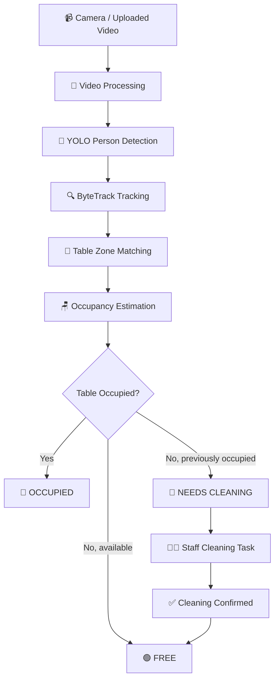
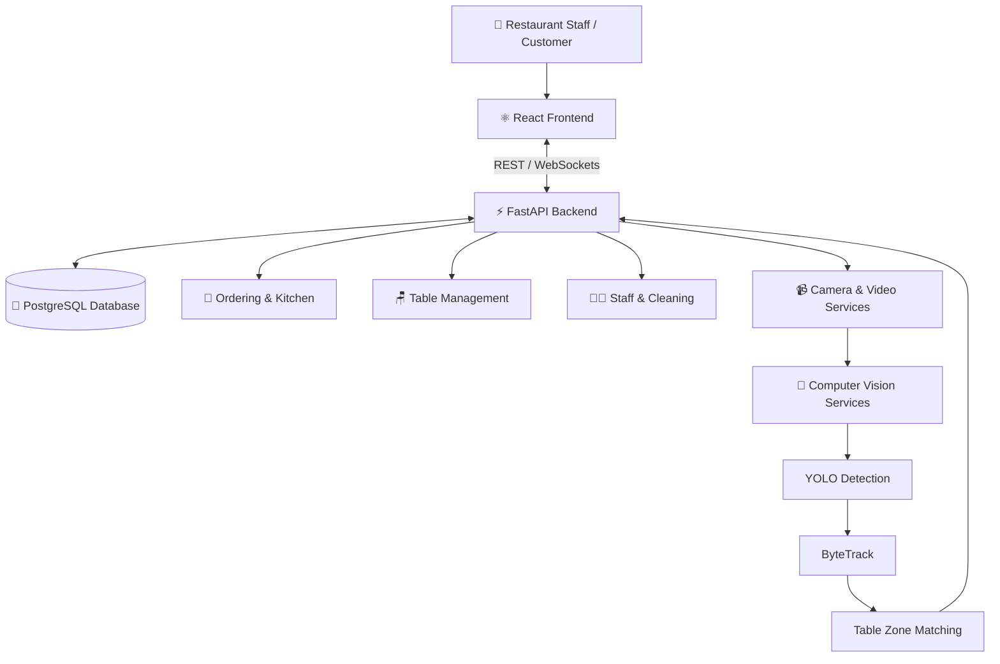

# 🍽️ RestroMind

<h1 align="center">🍽️ RestroMind</h1>

<h3 align="center">Restaurant Intelligence Workspace</h3>

<p align="center">
  <strong>Smarter Tables. Faster Service. Better Restaurant Operations.</strong>
</p>

<p align="center">
  An AI-powered restaurant management and monitoring workspace combining computer vision, table management, customer ordering, staff coordination and restaurant operations.
</p>

<p align="center">
  
  
  
  
  
</p>

<p align="center">
  
  
  
  
</p>

---

## ✨ About RestroMind

**RestroMind** is a restaurant intelligence workspace designed to simplify daily restaurant operations.

It brings table monitoring, customer ordering, kitchen operations, staff coordination, cleaning workflows and restaurant management together in one platform.

The project combines modern web technologies with AI-based computer vision to help restaurants monitor table occupancy and manage their operations more efficiently.

### 🎯 Our Vision

To build a smarter restaurant environment where technology helps restaurant owners and staff manage tables, orders, customers and daily operations from one place.

---

## 🚀 Features

<table>
<tr>
<td width="50%">

### 📊 Restaurant Dashboard
- Restaurant operations overview
- Table activity and status
- Orders and service activity
- Cleaning tasks and alerts

</td>
<td width="50%">

### 🪑 Table Management
- Create and manage tables
- Occupancy status
- Table availability
- Table-zone configuration
- Shared table sessions

</td>
</tr>
<tr>
<td width="50%">

### 📹 Live Camera Monitoring
- Browser camera support
- RTSP/IP camera integration
- Uploaded video processing
- Person detection
- Person tracking
- Table occupancy estimation

</td>
<td width="50%">

### 🧹 Cleaning Management
- Automatic cleaning alerts
- Table cleaning workflow
- Staff task assignment
- Cleaning confirmation
- Table status updates

</td>
</tr>
<tr>
<td width="50%">

### 🍔 Restaurant Ordering
- Digital restaurant menu
- Menu sizes and ingredients
- Customer ordering
- Order customization
- Checkout and payment tracking
- Shared table ordering
- Customer feedback

</td>
<td width="50%">

### 👨‍🍳 Staff & Kitchen Operations
- Staff management
- Staff assignments
- Kitchen order workflow
- Customer service requests
- Operational notifications
- Service request tracking

</td>
</tr>
<tr>
<td width="50%">

### 🎁 Customer Rewards
- Reward management
- Customer reward tracking
- Reward claims

</td>
<td width="50%">

### 📶 Restaurant Wi-Fi
- Wi-Fi settings management
- Encrypted credential storage

</td>
</tr>
</table>

---

## 🤖 AI & Computer Vision

RestroMind uses computer vision to estimate restaurant table occupancy.

<p align="center">
  
  
  
</p>

### How It Works



### Monitoring Workflow

1. Connect a supported camera or upload a video.
2. Configure polygon zones for restaurant tables.
3. Detect people using YOLO.
4. Track detected people using ByteTrack.
5. Match person positions with configured table zones.
6. Estimate table occupancy.
7. Generate a cleaning task when an occupied table becomes vacant.
8. Allow staff to complete and confirm cleaning.

> **Note:** Occupancy is an estimate. Accuracy depends on camera placement, lighting, occlusion, video quality and zone configuration.

---

## 🛠️ Technology Stack

| Category | Technologies |
|---|---|
| Frontend | React 19, TypeScript, Vite |
| Styling | Tailwind CSS |
| UI Components | Lucide React |
| Charts | Recharts |
| Data Management | TanStack Query |
| Routing | React Router |
| Backend | Python 3.11, FastAPI |
| Database | PostgreSQL 17 |
| ORM | SQLAlchemy |
| Migrations | Alembic |
| AI / Computer Vision | Ultralytics YOLO |
| Object Tracking | ByteTrack |
| Image Processing | OpenCV |
| Authentication | JWT |
| Encryption | Cryptography |
| API | REST API, WebSockets |
| Testing | Pytest, HTTPX |
| Code Quality | Ruff, Oxlint |
| Infrastructure | Docker Compose |

---

## 🏗️ System Architecture



---

## 📂 Project Structure

```text
RestroMind/
│
├── backend/
│   ├── alembic/
│   │   └── versions/
│   ├── app/
│   │   ├── api/
│   │   │   └── v1/
│   │   ├── core/
│   │   ├── db/
│   │   ├── models/
│   │   ├── schemas/
│   │   └── services/
│   ├── scripts/
│   ├── tests/
│   ├── requirements.txt
│   ├── pyproject.toml
│   └── alembic.ini
│
├── frontend/
│   ├── src/
│   │   ├── components/
│   │   └── services/
│   ├── package.json
│   └── package-lock.json
│
├── infrastructure/
│   └── docker-compose.yml
│
├── .env.example
├── .gitignore
└── README.md
```

---

## ⚙️ Installation & Setup

### Prerequisites

Make sure you have installed:

- Python 3.11
- Node.js and npm
- Docker and Docker Compose
- Git
- PostgreSQL through Docker Compose

### 1. Clone Repository

```bash
git clone https://github.com/Chaman4211/RestroMind.git
cd RestroMind
```

### 2. Configure Environment

```bash
cp .env.example .env
```

Generate secure secrets:

```bash
openssl rand -hex 32
```

Set unique values for the JWT secret and owner setup key in `.env`.

Keep your `.env` file private.

### 3. Start Database

```bash
docker compose --env-file .env -f infrastructure/docker-compose.yml up -d
```

Check database status:

```bash
docker compose --env-file .env -f infrastructure/docker-compose.yml ps
```

### 4. Backend Setup

```bash
cd backend

python3.11 -m venv .venv
source .venv/bin/activate

pip install -r requirements.txt
```

Apply database migrations:

```bash
.venv/bin/alembic upgrade head
```

Start the backend:

```bash
.venv/bin/uvicorn app.main:app --reload
```

Backend URL:

`http://127.0.0.1:8000`

API documentation:

`http://127.0.0.1:8000/docs`

### 5. Frontend Setup

Open another terminal:

```bash
cd ~/projects/restromind/frontend

npm install
npm run dev
```

Frontend URL:

`http://localhost:5173`

---

## 🔐 Demo Mode

RestroMind supports an optional public demo experience.

When `DEMO_MODE=true` is enabled:

- Visitors can open the workspace without a login screen.
- The frontend automatically requests a demo session.
- Normal login and owner setup routes are disabled.

For a normal installation, use:

```env
DEMO_MODE=false
```

For a public demo, use a separate demo database and configure:

```env
DEMO_MODE=true
```

**Important:** Never expose your development or production database through a public demo.

---

## 📡 API Modules

The backend API uses the `/api/v1` prefix.

| Module | Responsibility |
|---|---|
| Health | API health checks |
| Authentication | Owner setup, login and demo session |
| Notifications | Restaurant notifications |
| Alerts | Operational alerts |
| Camera Sources | Camera source management |
| Camera Stream | Camera streaming |
| Video Processing | Uploaded video processing |
| Restaurant Tables | Table management and occupancy |
| Staff | Staff management |
| Ordering | Menus, orders and checkout |
| Service Requests | Customer service workflows |
| Rewards | Customer rewards |
| Wi-Fi | Restaurant Wi-Fi settings |

Explore API endpoints:

`http://localhost:8000/docs`

---

## 🧪 Testing & Code Quality

### Backend Tests

```bash
cd backend
.venv/bin/python -m pytest -q
```

For running the authentication test suite with demo mode disabled:

```bash
DEMO_MODE=false .venv/bin/python -m pytest -q
```

### Backend Lint

```bash
cd backend
.venv/bin/python -m ruff check app tests
```

### Frontend Lint

```bash
cd frontend
npm run lint
```

### Frontend Production Build

```bash
npm run build
```

---

## 🗄️ Database Migrations

Show migration head:

```bash
cd backend
.venv/bin/alembic heads
```

Apply migrations:

```bash
.venv/bin/alembic upgrade head
```

Always take a verified backup before applying migrations to an important database.

---

## 🔒 Security

- Never commit `.env` or private credentials.
- Use unique and strong JWT and encryption keys.
- Do not expose PostgreSQL publicly.
- Protect camera credentials and RTSP URLs.
- Review camera, Wi-Fi, staff and video-processing endpoints before public deployment.
- Do not expose decrypted Wi-Fi credentials through public API responses.
- Use a separate database for public demos.
- Configure CORS for the intended frontend origin.

---

## 🚧 Current Scope & Limitations

RestroMind is actively developed. Some capabilities still require real-world validation.

- Table zones require manual configuration.
- Occupancy is estimated using computer vision.
- Detection accuracy depends on camera positioning and environmental conditions.
- RTSP camera compatibility requires testing with the target camera models.
- Real restaurant deployment requires additional testing and calibration.
- Advanced hygiene monitoring and inventory integrations are future improvements.

---

## 🔮 Future Improvements

- Advanced restaurant hygiene monitoring.
- Inventory intelligence and stock tracking.
- More camera integrations.
- Improved occupancy accuracy.
- Restaurant analytics and reporting.
- Multi-restaurant SaaS support.
- Additional AI-powered restaurant workflows.

---

## 👨‍💻 Developer

<p align="center">
  <strong>Chaman Afzaal</strong>
  <br/>
  Software Engineering Graduate
  <br/><br/>
  <a href="https://github.com/Chaman4211">
    
  </a>
</p>

---

<p align="center">
  <strong>🍽️ RestroMind — Bringing Intelligence to Restaurant Operations.</strong>
  <br/>
  <sub>Built with ❤️  and modern technology.</sub>
</p>
